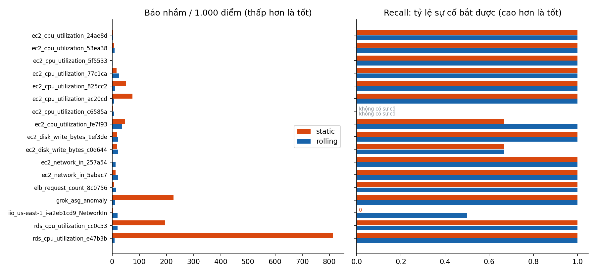
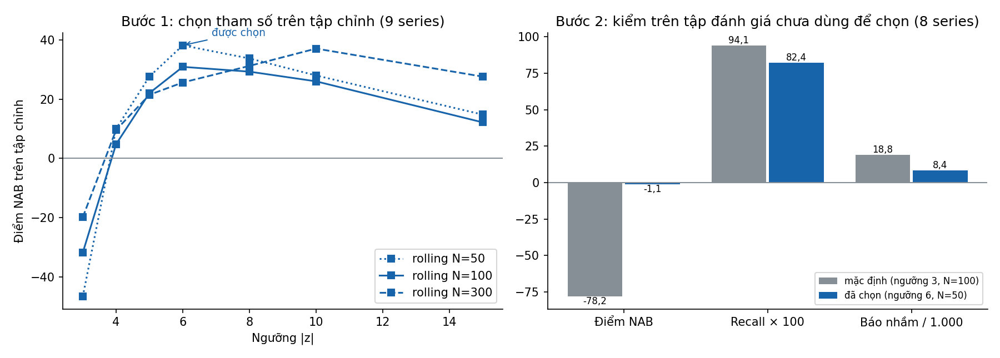
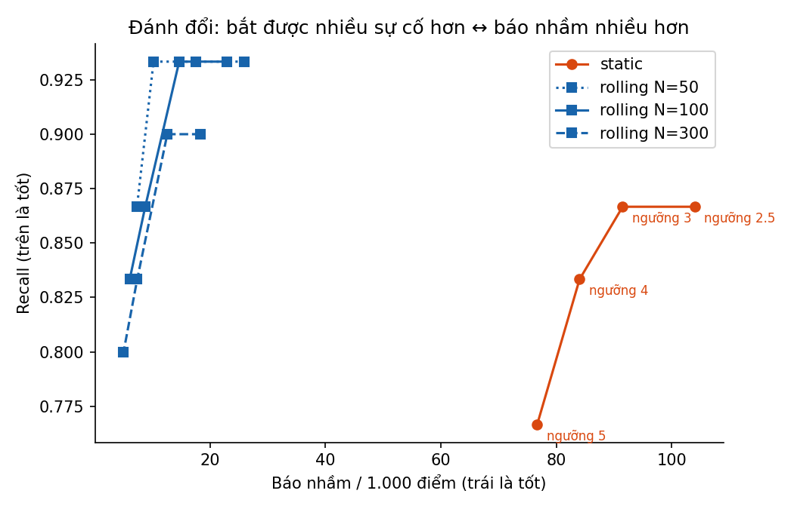
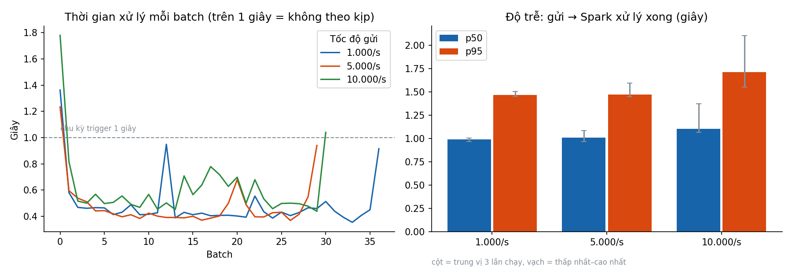
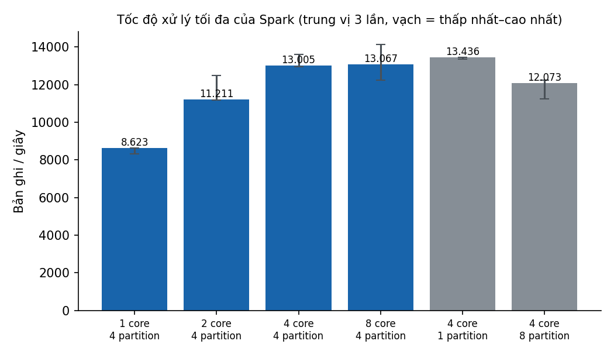

# Đánh giá mức độ hoàn thành dự án

> **Câu hỏi của report:** so với mục tiêu của mini project, nhóm đã hiện thực xong những gì, và có bằng chứng chạy thật hay chưa?
>
> **Dự án:** Scalable Real-Time Anomaly Detection on Operational Time-Series Data Using Apache Spark Structured Streaming (CO5135, nhóm 261_05)
> **Mục tiêu lấy từ:** slide [`design/brief.pdf`](../design/brief.pdf) (trang 2–3) và [proposal](../design/anomaly_detection_enhancement_proposal.md) (mục 8 và 10)
> **Ngày kiểm tra:** 15/11/2026, trên code nhánh `main` · MacBook 8 nhân, 16 GB RAM · Spark 3.5.1, Kafka 7.4 (Docker), Java 17, Python 3.11

Mọi con số trong report do [`run_assessment.py`](run_assessment.py) chạy trực tiếp trên code hiện tại. Số liệu gốc nằm trong [`results/`](results/).

---

## 1. Kết luận trong 30 giây

**20 / 20 mục tiêu đã hoàn thành và có bằng chứng chạy thật.**

- **Pipeline chạy thật từ đầu đến cuối:** NAB CSV → Python Replay → Kafka → Spark Structured Streaming → kết quả có cờ bất thường. Kết quả của Spark **khớp 100%** với bản tính tuần tự: 0 bản ghi thiếu, 0 trùng, 0 sai lệch, kiểm trên cả 17 series CloudWatch và qua Kafka.
- **Cả hai thuật toán** (Static và Rolling Z-score) đã có, được unit test và Spark test bảo vệ (9/9 test đạt).
- **Bám sát thời gian thực:** ở tốc độ 1.000–10.000 bản ghi/giây, Spark xử lý xong mỗi bản ghi trong khoảng **1 giây** (p95 dưới 1,8 giây, trung vị của 3 lần chạy).
- **Chịu được sự cố:** cố ý "giết" Spark giữa chừng rồi chạy lại, kết quả cuối vẫn đủ và đúng, không trùng.
- **Đã chấm điểm NAB chính thức trên đủ 17 series và tinh chỉnh tham số một cách công bằng:** chọn trên 9 series, kiểm trên 8 series còn lại. Trên phần kiểm, rolling với tham số đã chọn giảm báo nhầm hơn một nửa, điểm NAB tăng từ −78 lên khoảng 0. Mọi bài đo tốc độ đều chạy 3 lần và báo trung vị.
- **Điểm cần nói rõ khi thuyết trình:** điểm NAB của rolling sau tinh chỉnh chỉ ngang mức "không báo gì" (khoảng 0). Static âm rất sâu vì không theo kịp khi mức nền thay đổi. Phát hiện được sự cố là đạt, nhưng chất lượng theo thang NAB vẫn còn chỗ để cải thiện.

---

## 2. Bảng checklist mục tiêu

✅ Hoàn thành, có bằng chứng chạy thật

### A. Pipeline theo slide (trang 2: *NAB CSV → Python Replay → Kafka → Spark Streaming → Anomaly Alerts*)

| # | Mục tiêu | Hiện thực ở đâu | Bằng chứng | Kết quả |
| --- | --- | --- | --- | :-: |
| A1 | Dùng dữ liệu NAB, tập con `realAWSCloudwatch` | `data/realAWSCloudwatch/` (17 file), nhãn `labels/combined_windows.json` | Cả 17 file, 67.740 bản ghi đi qua pipeline | ✅ |
| A2 | Python Replay giả lập luồng dữ liệu sống | `script/replay_anomaly.py`, `anomaly_detection/replay.py` | Gửi đúng tốc độ đặt: 1.000 → 1.000/s, 5.000 → 4.998/s, 10.000 → 9.995/s | ✅ |
| A3 | Kafka làm hàng đợi trung gian | `docker-compose.yml`, topic riêng cho từng lần chạy | 36.288 bản ghi qua Kafka, Spark đọc đủ, không mất bản ghi nào | ✅ |
| A4 | Spark Structured Streaming xử lý luồng | `script/run_detection.py`, `anomaly_detection/stateful.py` | Chạy liên tục với trigger 1 giây, lưu state theo từng metric | ✅ |
| A5 | Xuất cảnh báo bất thường (Anomaly Alerts) | Cột `is_anomaly`, `static_anomaly`, `rolling_anomaly` trong output Parquet | Bộ quan sát đọc được 261 / 1.044 / 2.175 cảnh báo ở 3 mức tốc độ | ✅ |

### B. Thuật toán (slide trang 3: *Static and Rolling Z-score*)

| # | Mục tiêu | Hiện thực ở đâu | Bằng chứng | Kết quả |
| --- | --- | --- | --- | :-: |
| B1 | Static Z-score | `anomaly_detection/calibration.py`, `statistics.py` | Học mức bình thường từ 15% dữ liệu đầu cho từng metric; có test | ✅ |
| B2 | Rolling Z-score | `anomaly_detection/statistics.py` (`RollingHistory`) | So với 100 điểm trước, không dùng chính nó; test đối chiếu 2.000 lần cập nhật | ✅ |

### C. Bốn vấn đề trong Problem Statement (slide trang 3)

| # | Vấn đề cần giải | Bằng chứng | Kết quả |
| --- | --- | --- | :-: |
| C1 | **Dynamic data patterns**: mức bình thường thay đổi theo thời gian | Trên 17 series, rolling báo nhầm **14,6** lần / 1.000 điểm, static **91,5** lần. Rolling tự thích nghi khi mức nền dời đi | ✅ |
| C2 | **Detection reliability**: cân bằng giữa bắt sự cố và báo nhầm | Chọn ngưỡng và N trên 9 series theo điểm NAB, giữ nguyên rồi kiểm trên 8 series chưa dùng (mục 3.3): báo nhầm giảm từ 18,8 xuống 8,4 / 1.000, recall từ 0,94 xuống 0,82 | ✅ |
| C3 | **Processing latency**: cảnh báo kịp thời | Gửi → xử lý xong: p50 khoảng 1,0–1,1 s, p95 khoảng 1,5–1,7 s ở 1.000–10.000 bản ghi/s | ✅ |
| C4 | **Streaming scalability**: ổn định khi tải tăng | Tải tăng 10 lần (1.000 → 10.000/s) mà độ trễ p50 chỉ tăng từ 0,99 lên 1,11 s. Khi xả hàng đợi đầy, Spark xử lý được khoảng 13.000 bản ghi/s với 4 core | ✅ |

### D. Mục tiêu đánh giá (slide trang 3: *Evaluation Objectives*)

| # | Phải đo | Đã đo | Kết quả |
| --- | --- | --- | :-: |
| D1 | NAB score | Bộ chấm chính thức của NAB trên đủ 17 series (mục 3.2): tham số mặc định static −806,9, rolling −58,0; rolling sau tinh chỉnh +15,9 | ✅ |
| D2 | False-alarm rate | Đủ 17 series, từng series và tổng (mục 3.2) | ✅ |
| D3 | Throughput | Ở tốc độ gửi thật và ở chế độ "xả" hàng đợi đầy (mục 3.4, 3.5) | ✅ |
| D4 | Alert latency | Độ trễ xử lý và thời điểm cảnh báo thực sự xuất hiện ở output (mục 3.4) | ✅ |
| D5 | Scalability theo tốc độ đầu vào và cấu hình Spark | 3 mức tốc độ; 1/2/4/8 core; 1/4/8 partition Kafka. Mỗi cấu hình đo 3 lần, báo trung vị kèm khoảng thấp nhất–cao nhất (mục 3.4, 3.5) | ✅ |

### E. Bốn milestone của proposal (mục 10)

| # | Milestone và tiêu chí nghiệm thu | Bằng chứng | Kết quả |
| --- | --- | --- | :-: |
| E1 | **Detector contract**: kết quả đúng với tín hiệu phẳng, gai nhọn, nhiều metric tách biệt | 7 unit test và 10 kịch bản trên trang *Correctness checks* của web demo | ✅ |
| E2 | **Ordered Spark stream**: điểm của Spark khớp bản tính tuần tự, lịch sử giữ được qua các micro-batch | 67.740 / 67.740 bản ghi khớp (file) và 36.288 / 36.288 (Kafka) | ✅ |
| E3 | **Recovery và disorder**: chạy lại sau sự cố khớp lần chạy liền mạch; dữ liệu đến trễ xử lý đúng chính sách | Crash giữa chừng → 12.096 / 12.096 khớp, 0 trùng. Spark test xác nhận watermark xếp lại đúng thứ tự | ✅ |
| E4 | **Evaluation và reporting**: bảng chất lượng, biểu đồ, manifest tái lập được, điểm NAB | Có đủ bảng, biểu đồ, manifest và hash dữ liệu; điểm NAB cho cả 17 series, bộ chấm cố định ở revision `ea702d7` | ✅ |

---

## 3. Chi tiết và hình minh họa

### 3.1 Pipeline chạy đúng: Spark khớp với bản tính tay

Cùng một chuỗi sự kiện được chấm 2 lần: một lần bằng Spark, một lần tuần tự bằng Python thuần (`script/reference_anomaly.py`). Sau đó so từng bản ghi: giá trị, cờ bất thường và z-score (sai số cho phép 10⁻⁸).

| Lần kiểm | Nguồn vào | Số bản ghi | Thiếu | Thừa | Trùng | Sai lệch |
| --- | --- | ---: | :-: | :-: | :-: | :-: |
| 17 series CloudWatch | file JSONL | 67.740 | 0 | 0 | 0 | 0 |
| 3 series × 3 bản sao | **Kafka**, 1.000 bản ghi/s | 36.288 | 0 | 0 | 0 | 0 |
| Crash rồi chạy lại | **Kafka** | 12.096 | 0 | 0 | 0 | 0 |

**Ý nghĩa:** chia dữ liệu thành micro-batch, lưu state vào checkpoint và chạy song song trên nhiều luồng **không làm sai kết quả**.

### 3.2 Chất lượng phát hiện trên 17 series

| | Static | Rolling |
| --- | ---: | ---: |
| Sự cố bắt được (recall) | 26 / 30 (**0,87**) | 28 / 30 (**0,93**) |
| Báo nhầm | 5.270 lần | 843 lần |
| Báo nhầm / 1.000 điểm | **91,5** | **14,6** |



**Vì sao static báo nhầm nhiều đến vậy?** Static học mức bình thường từ 15% dữ liệu đầu rồi giữ cố định. Khi hệ thống đổi mức nền, static coi mọi thứ sau đó là bất thường. Ví dụ rõ nhất là `rds_cpu_utilization_e47b3b`:

| | Đoạn học (15% đầu) | Phần còn lại |
| --- | ---: | ---: |
| CPU trung bình | 13,7 | 19,9 |
| Độ lệch chuẩn | 0,5 | 5,6 |
| Báo nhầm | static **2.786** lần | rolling **30** lần |

Đây chính là vấn đề *Dynamic data patterns* trong slide, và rolling giải được nó.

**Điểm NAB chính thức trên 17 series** (bộ chấm gốc của Numenta, revision `ea702d7`, profile `standard`, tham số mặc định ngưỡng 3, N = 100):

| Detector | Điểm NAB (0 = không báo gì, 100 = hoàn hảo) |
| --- | ---: |
| Static | **−806,9** |
| Rolling | **−58,0** |

**Đọc điểm này thế nào?** Điểm âm nghĩa là kém hơn một detector không bao giờ báo động. NAB phạt **mỗi điểm** báo nhầm, và pipeline báo ở mọi điểm vượt ngưỡng (không gộp các báo động liền nhau). Vì vậy một đoạn dài bị đánh dấu sẽ bị trừ điểm rất nhiều lần. Phần lớn điểm âm của static đến từ vài series đổi mức nền: `rds_cpu_utilization_e47b3b` (−292,5 điểm thô), `rds_cpu_utilization_cc0c53` (−59,7) và `grok_asg_anomaly` (−90,0). Rolling cũng âm ở hầu hết series nhưng nhẹ hơn nhiều. Điểm từng series nằm trong [`results/nab.json`](results/nab.json).

Lưu ý: đây là điểm trên 17 series đã chọn, không so trực tiếp được với bảng xếp hạng NAB đầy đủ (58 series).

### 3.3 Tinh chỉnh tham số: chọn trên một nửa, kiểm trên nửa kia

Với tham số mặc định, điểm NAB âm, nên cần chỉnh ngưỡng và N. Để kết quả công bằng (không "học tủ" đáp án), 17 series được chia làm hai:

- **Tập chỉnh (9 series, 13 sự cố):** thử ngưỡng 3, 4, 5, 6, 8, 10, 15 và N = 50, 100, 300, chọn cấu hình có điểm NAB cao nhất.
- **Tập đánh giá (8 series, 17 sự cố):** không dùng khi chọn. Cấu hình đã chọn được giữ nguyên và chỉ chấm trên tập này đúng một lần.

Hai tập lấy xen kẽ theo tên file, nên mỗi tập có đủ các loại CPU, disk, network và request. Danh sách file nằm trong [`results/tuning.json`](results/tuning.json).



**Kết quả của rolling** (cấu hình được chọn: **ngưỡng 6, N = 50**):

| Trên tập đánh giá (8 series) | Mặc định (ngưỡng 3, N = 100) | Đã chọn (ngưỡng 6, N = 50) |
| --- | ---: | ---: |
| Điểm NAB | −78,2 | **−1,1** |
| Sự cố bắt được | 16 / 17 (0,94) | 14 / 17 (0,82) |
| Báo nhầm / 1.000 điểm | 18,8 | **8,4** |

Trên cả 17 series, cấu hình đã chọn đạt điểm NAB **+15,9** (mặc định −58,0): bắt 25/30 sự cố, báo nhầm 6,0 / 1.000.

**Static** không cứu được bằng cách chỉnh ngưỡng. Cấu hình tốt nhất trên tập chỉnh là ngưỡng 15, nhưng trên tập đánh giá vẫn đạt **−399,5** điểm và chỉ bắt 3/17 sự cố. Lý do là khi mức nền đã dời đi thì ngưỡng nào cũng báo sai cả đoạn dài. Kết quả này củng cố kết luận ở mục 3.2: rolling mới là cách giải vấn đề *Dynamic data patterns*.

**Đánh đổi** (cùng 17 series, recall và báo nhầm, chạy offline bằng chính engine của Spark):



**Kết luận:** chỉnh tham số giảm báo nhầm hơn một nửa trên dữ liệu chưa thấy, đổi lại bỏ sót thêm 2 sự cố. Điểm NAB của rolling trên tập đánh giá lên khoảng 0, tức ngang mức "không báo gì". Muốn vượt hẳn mức này cần thay đổi thuật toán, không chỉ chỉnh tham số. Ví dụ: chỉ báo một lần cho mỗi chuỗi điểm bất thường liền nhau.

Pipeline vẫn chạy mặc định ngưỡng 3, N = 100, vì mọi bài đo khác trong report dùng cấu hình này. Muốn chạy với cấu hình đã chọn thì thêm `--threshold 6 --history-size 50` vào `script/run_detection.py`.

### 3.4 Độ trễ qua Kafka

Chạy thật: Spark chạy trước, rồi Python Replay gửi dữ liệu vào Kafka ở tốc độ cố định, mỗi lần chạy khoảng 15–40 giây. **Mỗi mức tốc độ chạy 3 lần**, bảng ghi trung vị, trong ngoặc là thấp nhất–cao nhất.

| Tốc độ gửi (đặt → đạt được) | Số metric | Gửi → xử lý xong p50 | p95 | Cảnh báo xuất hiện ở output p50 / p95 | Spark xử lý hết sau khi ngừng gửi |
| --- | ---: | ---: | ---: | ---: | ---: |
| 1.000 → 1.000 /s | 9 | **0,99 s** (0,97–1,00) | **1,47 s** (1,45–1,50) | 1,4 s / 2,2 s | 1,5 s |
| 5.000 → 4.998 /s | 36 | **1,01 s** (0,97–1,09) | **1,47 s** (1,45–1,60) | 2,0 s / 3,3 s | 1,5 s |
| 10.000 → 9.995 /s | 75 | **1,11 s** (1,07–1,37) | **1,71 s** (1,55–2,10) | 2,7 s / 4,5 s | 2,0 s |



**Đọc bảng:**
- Ở cả 3 mức, độ trễ khoảng 1 giây, phần lớn là thời gian chờ chu kỳ trigger 1 giây. Biểu đồ bên trái cho thấy mỗi batch thường xử lý xong trong 0,4–0,8 giây, dưới chu kỳ 1 giây, nên dữ liệu không bị dồn. Riêng batch đầu tiên chậm hơn vì Spark còn khởi động.
- Kafka không bị tồn đọng: số bản ghi còn chờ trong topic sau mỗi batch bằng 0 ở cả 9 lần chạy.
- 3 lần chạy cho kết quả gần nhau (khoảng thấp nhất–cao nhất hẹp), nên con số đáng tin.
- Cột "cảnh báo xuất hiện" cộng thêm tối đa 1 giây do bộ quan sát kiểm tra output mỗi giây một lần.

*So với lần đo trước:* trước đây producer Python chỉ gửi được khoảng 7.500/s khi đặt 10.000/s, và độ trễ đo được lên tới 7 giây. Sau khi sửa producer (gửi theo lô lớn hơn, xem mục 4), producer đạt đúng 10.000/s và Spark vẫn theo kịp.

### 3.5 Tốc độ xử lý theo cấu hình Spark

Bài này nạp sẵn 120.990 bản ghi (30 metric) vào Kafka rồi mới bật Spark, sau đó đo thời gian Spark xử lý hết hàng đợi. Mỗi batch đọc tối đa 20.000 bản ghi. **Mỗi cấu hình chạy 3 lần**, bảng ghi trung vị.

| Cấu hình | Bản ghi / giây (trung vị) | Thấp nhất–cao nhất | So với 1 core |
| --- | ---: | ---: | ---: |
| 1 core, 4 partition | 8.623 | 8.326–8.624 | 1,0× |
| 2 core, 4 partition | 11.211 | 11.192–12.499 | 1,30× |
| **4 core, 4 partition** | **13.005** | 12.955–13.595 | **1,51×** |
| 8 core, 4 partition | 13.067 | 12.237–14.121 | 1,52× |
| 4 core, 1 partition | 13.436 | 13.359–13.452 | 1,56× |
| 4 core, 8 partition | 12.073 | 11.235–12.232 | 1,40× |



**Đọc bảng:**
- Thêm core giúp tăng tốc đến 4 core (khoảng +50%). Lên 8 core không nhanh hơn nữa; khác biệt nằm trong độ dao động giữa các lần chạy.
- Đổi số partition Kafka (1, 4, 8) chỉ thay đổi khoảng ±5–10%. Nút thắt không nằm ở việc đọc Kafka mà ở bước chấm điểm theo từng metric bằng Python bên trong Spark (`applyInPandasWithState`).
- Bộ nhớ state chỉ khoảng **70 KB cho 30 metric** (100 giá trị gần nhất mỗi metric), không phình theo số bản ghi.
- Đây là tốc độ xả hàng đợi đầy với batch lớn, không phải tốc độ chạy liên tục. Ở mục 3.4, Spark chạy liên tục ở 10.000/s với độ trễ khoảng 1 giây.

### 3.6 Chịu lỗi: tắt đột ngột rồi chạy lại

| Bước | Kết quả |
| --- | --- |
| Gửi 12.099 bản ghi vào Kafka, Spark đọc 400 bản ghi mỗi batch | 31 batch tổng cộng |
| Sau 8 batch: **kill -9** toàn bộ Spark (driver và JVM), không cho dọn dẹp | Spark chết giữa chừng |
| Chạy lại đúng lệnh cũ, dùng lại checkpoint | Batch mới đầu tiên xong sau **5,9 giây** |
| So kết quả cuối với bản tính tuần tự | **12.096 / 12.096 khớp, 0 thiếu, 0 trùng** |

### 3.7 Kiểm thử tự động

**9 / 9 test đạt**, gồm cả 2 test chạy Spark thật (`RUN_SPARK_TESTS=1`).

| Test | Kiểm tra điều gì |
| --- | --- |
| `test_prior_history_and_flat_jump` | Điểm hiện tại không tự góp vào mức nền của chính nó; tín hiệu phẳng nhảy vọt vẫn bị bắt |
| `test_numerical_reference_with_eviction` | Trung bình / độ lệch chuẩn cuốn chiếu khớp cách tính trực tiếp qua 2.000 lần cập nhật |
| `test_state_survives_batches_and_restart` | Chia batch và lưu/khôi phục state cho kết quả giống chạy một lần |
| `test_buffer_reorders_across_batches_and_drains` | Dữ liệu đến lộn xộn được xếp lại đúng thứ tự thời gian |
| `test_late_duplicate_invalid_and_unknown_do_not_pollute_history` | Dữ liệu trùng, trễ, lỗi, lạ bị loại và không làm bẩn lịch sử |
| `test_per_metric_isolation_and_config_guard` | Các metric không lẫn state; đổi cấu hình thì không dùng lại checkpoint cũ |
| `test_window_evaluation_has_distinct_false_alert_and_hit_counts` | Cách đếm "bắt được" và "báo nhầm" đúng |
| `test_restart_matches_sequential_reference_and_commits_once` *(Spark)* | Spark dừng rồi chạy lại: khớp bản tính tuần tự, không ghi trùng |
| `test_watermark_timeout_drains_out_of_order_values` *(Spark)* | Watermark của Spark xả đúng dữ liệu đến trễ |

Ngoài ra trang **Correctness checks** của [web demo](../webui/README.md) có 10 kịch bản trực quan, đều đạt.

---

## 4. Các mục đã hoàn tất trong lần cập nhật này (15/11/2026)

Lần đánh giá đầu có 4 mục mới hoàn thành một phần. Cả 4 mục đã được làm xong:

| Việc | Giải quyết mục | Kết quả |
| --- | --- | --- |
| Chấm điểm NAB chính thức cho đủ 17 series (bước `nab`) | D1, E4 | Mục 3.2 và [`results/nab.json`](results/nab.json) |
| Chọn ngưỡng và N trên tập chỉnh, giữ nguyên rồi kiểm trên tập đánh giá (bước `tuning`) | C2 | Mục 3.3 và [`results/tuning.json`](results/tuning.json) |
| Lặp mỗi bài đo tốc độ 3 lần, báo trung vị kèm khoảng thấp nhất–cao nhất | D5 | Mục 3.4, 3.5 |
| Sửa `replay_anomaly.py --rate 0`: trước đây bị timeout khi gửi khoảng 240 nghìn bản ghi. Giờ flush mỗi 20.000 bản ghi và gửi theo lô lớn hơn; 241.920 bản ghi xong trong khoảng 16 giây | C4 | Bài đo ở mục 3.5 nạp dữ liệu không giới hạn tốc độ |
| Cập nhật [validation report](../design/results/anomaly_validation.md): ghi rõ Kafka đã được kiểm chứng | — | Mục "Follow-up results" ở cuối file |

**Nếu muốn làm tốt hơn nữa** (ngoài phạm vi mục tiêu): điểm NAB của rolling trên tập đánh giá mới ở mức khoảng 0. Hướng cải thiện dễ nhất là chỉ báo một lần cho mỗi chuỗi điểm bất thường liền nhau, vì NAB phạt từng điểm báo nhầm.

---

## 5. Cách chạy lại

Cần `.venv-anomaly` và Java 17 như trong [runbook](../design/anomaly_pipeline_runbook.md). Các bài dùng Kafka cần Docker đang chạy; script tự bật `zookeeper` và `broker`.

```bash
.venv-anomaly/bin/python assess/run_assessment.py tests quality nab tuning sensitivity
```

```bash
.venv-anomaly/bin/python assess/run_assessment.py live recovery capacity
```

```bash
.venv-anomaly/bin/python assess/run_assessment.py charts
```

Bước `nab` và `tuning` tự tải bộ chấm NAB gốc (revision `ea702d7`) vào `anomaly_runs/assess/nab-upstream`, hoặc dùng thư mục trong biến `NAB_ROOT`. Chạy đầy đủ mất khoảng 1 giờ, phần lớn là các bài đo tốc độ lặp 3 lần. Dữ liệu thô nằm ở `anomaly_runs/assess/` (không commit); mỗi bài khi chạy lại sẽ tạo lại thư mục của nó. Số liệu tốc độ phụ thuộc vào máy, nên tắt các ứng dụng nặng khi đo.

Nếu broker không lên và log báo `NodeExistsException`, đó là do ZooKeeper còn giữ phiên cũ. Chạy lại `docker compose up -d broker` sau vài giây là được.

---

## Phụ lục: giải thích thuật ngữ

| Thuật ngữ | Nghĩa đơn giản |
| --- | --- |
| **Static Z-score** | So mỗi giá trị với một mức "bình thường" cố định, học từ 15% dữ liệu đầu. |
| **Rolling Z-score** | So mỗi giá trị với 100 giá trị ngay trước nó, nên mức "bình thường" tự trôi theo dữ liệu. |
| **Sự cố (window)** | Khoảng thời gian bộ NAB đánh dấu là có sự cố thật. Đây là đáp án. |
| **Recall** | Trong các sự cố, bắt được bao nhiêu phần (1 = bắt hết). |
| **Báo nhầm / 1.000 điểm** | Số lần báo động ngoài mọi vùng sự cố, tính trên mỗi 1.000 điểm dữ liệu. |
| **NAB score** | Điểm chính thức của bộ benchmark NAB: thưởng phát hiện sớm, phạt báo nhầm. 0 = không làm gì, 100 = hoàn hảo. |
| **Khớp (parity)** | Kết quả của Spark giống hệt bản tính tuần tự không qua Spark. |
| **p50 / p95** | 50% / 95% bản ghi xong trong khoảng thời gian này. |
| **Trigger 1 giây** | Cứ mỗi giây Spark gom dữ liệu mới thành một batch để xử lý. |
| **Checkpoint** | Nơi Spark lưu tiến độ và state để chạy tiếp sau khi bị dừng. |
| **local[N]** | Spark chạy với N luồng xử lý song song. |
| **Partition (Kafka)** | Topic Kafka được chia thành nhiều phần để đọc song song. |
