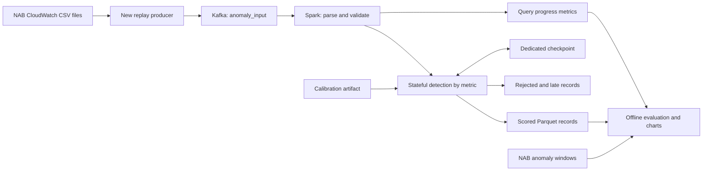

# Proposal: Stateful Streaming Anomaly Detection

Status: approved design. The separate detector pipeline and validation tools are implemented; see [runbook](anomaly_pipeline_runbook.md) and [validation results](results/anomaly_validation.md). Kafka end-to-end and capacity experiments remain pending while Docker Desktop is paused. The sections below describe the approved design and planned experiment scope.

Project: **Scalable Real-Time Anomaly Detection on Operational Time-Series Data Using Apache Spark Structured Streaming**  
Course: HCMUT CO5135 — Big Data  
Reference: `design/brief.pdf` and the existing standalone `detection.py`.

## 1. Objective and scope

Extend the offline detector into a measurable distributed streaming application. Keep static and rolling Z-score as the two primary algorithms promised in the slides. Demonstrate how Spark maintains detector state, handles event ordering, recovers after interruption, and behaves under increasing input rates.

The public CO5135 syllabus includes parallel/distributed computing, Spark analytics, and streaming. This proposal aligns with those topics; it does not claim to reproduce the current instructor's project grading rubric. See the [HCMUT syllabus](https://grad.hcmut.edu.vn/gv/front.php/capnhatdecuong/public/printdecuongcdio?mamh=055153&manganh=8440214&option=tv).

Implement the enhancement through new modules and a separate entry point. The existing ingestion scripts remain usable. A small optional extension is rolling median/MAD for a robustness comparison, after the core experiments are complete.

## 2. Current gaps

| Current behavior | Consequence | Proposed enhancement |
| --- | --- | --- |
| `detect_anomalies()` materializes records in Python lists | Requires memory proportional to the input | Incremental processing on Spark executors |
| Rolling history is local to each function call | History disappears between micro-batches | Checkpointed state keyed by metric |
| One history for all records passed to the detector | Different metrics can contaminate each other's baselines | Separate state for every metric ID |
| Input order is assumed | Delayed events can corrupt a prior-observation baseline | Explicit ordering and late-event policy |
| Zero standard deviation produces no score | A jump from a flat signal can be missed | Explicit constant-baseline rule |
| Exact timestamp label matching | Does not implement the slide's NAB window evaluation | Window metrics plus official NAB scoring |
| No measured scaling or recovery | Project title is not supported by evidence | Controlled load and restart experiments |

## 3. Proposed architecture



Use a single append output containing a `record_status` field so scores and rejected records can share one recoverable sink. Offline views extract alerts and rejected events. This avoids coordinating independent sinks in the first implementation.

Spark uses the existing pinned PySpark 3.5.1, Java 17, and Python 3.11 or 3.12. The Python stateful API requires compatible Pandas and PyArrow installations; declare these in a separate enhancement dependency file and document installation before implementation. The current local virtual environment must be checked against the supported Python range.

## 4. Input contract and replay

The new producer reads the existing NAB CSV files without modifying them. Proposed message:

```json
{
  "run_id": "cloudwatch-quality-001",
  "metric_id": "realAWSCloudwatch/ec2_cpu_utilization_24ae8d.csv",
  "event_id": "cloudwatch-quality-001:series-01:150",
  "sequence": 150,
  "event_time": "2014-02-15T03:00:00Z",
  "value": 0.132,
  "sent_at": "2026-11-10T14:00:00Z",
  "is_control": false
}
```

- Key Kafka messages by `metric_id`; one producer owns each metric during a run. Assign a monotonically increasing sequence per metric.
- Use the relative NAB file path as metric identity so evaluation can join directly to label keys.
- Interpret timezone-free NAB timestamps consistently as UTC for this project, documenting this convention. Preserve the original timestamp in evaluation exports.
- Record `sent_at` immediately before sending. Producer acknowledgment and Kafka settings must be recorded with experiment results.
- Provide replay rate, selected files, and bounded out-of-order injection options. Use a fresh topic/checkpoint/output path for each independent experiment.
- Persist the run manifest: files, configuration, random seed, software versions, and hardware resources.

For capacity experiments, replay independent metric copies with unique IDs. Their timestamps and values are copies of the source, so they increase workload but do not add independent evidence about detection quality. Interleave metric copies by event time.

## 5. Detection algorithms

### Static Z-score

For each metric, calculate a fixed mean and population standard deviation from a declared chronological calibration prefix. Save statistics, calibration endpoint, sample count, and source path in an immutable artifact. Skip that prefix when measuring evaluation quality. Fit parameters without using evaluation labels; document that the prefix is assumed representative and may contain anomalies.

For an evaluation value `x`, score `z = (x - mean) / stddev` and alert when `abs(z) >= threshold`. Each metric requires its own parameters. Missing calibration produces an explicit status instead of silently using mean 0 and standard deviation 1.

### Rolling Z-score

Maintain the previous `N` accepted observations per metric. For each event:

1. Read the prior history and its mean/standard deviation.
2. If there are fewer than `min_periods` observations, emit `warmup` with no rolling decision.
3. Otherwise calculate the score and anomaly flag.
4. Add the current observation and evict the oldest value if necessary.

The current value must never contribute to its own baseline. Begin with `N=100`, `min_periods=20`, and threshold 3 as experiment defaults, not established optimal values. Compare sensitivity to `N` and threshold on development data, then freeze them before final evaluation.

Keep a fixed-size history and running moments. Use a numerically stable update/removal method, guard against small negative variance from rounding, and periodically reconcile moments with the stored history. State is O(N) per metric; a direct history calculation is an acceptable reference implementation for correctness comparison.

For a baseline with standard deviation below a documented epsilon, flag a deviation only when `abs(x - mean)` exceeds a metric-specific absolute tolerance. Otherwise classify the observation as normal. Emit a `constant_baseline` reason and a null Z-score to avoid representing division by zero as a finite statistic. Define tolerances before final evaluation.

Evaluate static and rolling outputs separately. A combined OR flag may be convenient for a demo, but it must not replace the comparison of each detector's quality.

## 6. Spark state and event-time policy

Use `groupBy(metric_id).applyInPandasWithState(...)`, append output, explicit state/output schemas, and a dedicated checkpoint. Run detection and output construction in one stateful operator, avoiding stream-to-stream joins between separate detector branches. This API maintains state across invocations and requires a shuffle; see [Apache Spark's API documentation](https://spark.apache.org/docs/3.5.6/api/python/reference/pyspark.sql/api/pyspark.sql.GroupedData.applyInPandasWithState.html). The linked documentation is from the same 3.5 release line; implementation must check the installed 3.5.1 signature.

Two explicit execution modes make the latency tradeoff measurable:

| Mode | Ordering policy | Intended experiment |
| --- | --- | --- |
| Ordered replay, default | Producer sends each metric chronologically; sort all chunks for a metric within a batch; reject events preceding the last accepted ordering key | Primary quality and low-latency performance runs |
| Bounded disorder | Buffer events in state and release in event-time order when the watermark passes them | Delayed-event correctness and latency tradeoff |

Sorting only within a micro-batch does not fix disorder across batches. The ordering key is `(event_time, sequence)`. Duplicate/replayed sequence values are rejected under the defined single-producer sequence contract. Rejected records must not update the baseline.

For bounded disorder, use `withWatermark` and event-time timeouts to release buffered events, including timeout callbacks with empty input. Events already behind the watermark are outside the accepted lateness policy; do not revise previously emitted scores. Spark may discard such rows before the user function, so retain the Kafka input for audit and report engine late-drop counters separately from application rejection counts.

The watermark is global across the query. Replaying unrelated historical ranges together can make an older metric look late; select aligned series ranges or run them separately. A watermark is an event-time progress boundary, not a wall-clock timer. At finite replay completion, send tagged control events that advance event time sufficiently to drain the buffer; control events do not enter baselines or quality metrics. An idle stream cannot promise a wall-clock flush without an additional mechanism.

State contains the history, moments, last ordering key, calibration identity, and optional pending events. Cap pending records per metric and reject overflow with a counter. History is bounded per metric; total memory also depends on metric count. For the fixed NAB subset, allowlist metric IDs. If supporting unbounded identities later, add and evaluate an explicit idle-state eviction policy.

A previous-N-observations baseline is not a time-duration sliding window. Present this distinction in the seminar: watermarks support ordering/late-data policy here; they do not turn the detector into a Spark window aggregation.

## 7. Outputs, latency, and recovery

Each scored row carries run/event/metric identity, original timestamp/value, both detector scores and flags, baseline sample count, status/reason, and configuration version. Keep warmup and rejected statuses distinct from normal observations.

Persist micro-batch progress separately: batch ID, input rows, input and processing rates, trigger duration, state rows/memory, and watermark/late-drop metrics where available. Progress callbacks should write asynchronously to avoid blocking processing.

Define three time measurements:

- Event-time detection delay: first alert timestamp minus the start of its labeled anomaly window.
- Processing completion proxy: driver-observed successful batch completion time minus `sent_at`, joined by batch ID recorded in the score output. This includes batching and state processing; it is an estimate, not an individual sink acknowledgment time.
- Alert availability latency: an external observer's first sight of a committed alert minus `sent_at`, with polling interval documented. Use this for an end-to-end claim.

Do not use old NAB timestamps to calculate transport latency. Synchronize clocks for multiple hosts and report polling overhead. A Spark `current_timestamp()` field alone is not evidence of sink visibility time.

Use Spark's checkpoint and file-sink commit metadata. Restart with the same input, checkpoint, output, and compatible state schema. Compare committed event IDs and scores against an uninterrupted reference run after a controlled interruption; inspect both missing and duplicate records. Do not promise exactly-once behavior for arbitrary future external sinks. State-schema or algorithm changes require a new run unless an explicit migration is implemented.

## 8. Evaluation protocol

### Detection quality

Start with several predeclared CloudWatch series covering CPU and other operational metrics, including a series with no labeled windows. Expand to the full available subset when the pipeline is stable.

Use `labels/combined_windows.json`; exact point matching against `combined_labels.json` is insufficient for the proposed window evaluation. Freeze data splits and detector parameters before final reporting. Both detectors must use the same evaluation range; earlier observations may initialize rolling state without contributing to measured metrics.

Report per-series and aggregate results:

- Window recall: labeled windows containing an alert divided by eligible labeled windows.
- Missed windows and the number of alerts outside all eligible windows.
- False alerts per 1,000 evaluated observations, with any cooldown rule stated.
- First-alert delay within each detected window, including median and p95 where sample size permits.
- Official NAB score using the upstream scorer, profile, and probation rules, because the slides promise NAB scoring.

Basic window counts and point-level precision/recall are different metrics. Do not label a custom window hit calculation as NAB score. Export continuous detector scores in the format required by the scorer and document the score mapping/threshold policy. Verify upstream subset scoring support and normalization for the chosen NAB revision before claiming a normalized subset score. The upstream README documents limitations for its custom-window subset option. See [NAB repository](https://github.com/numenta/NAB) and the [NAB scoring paper](https://arxiv.org/abs/1510.03336).

### Streaming performance and scalability

Use a staged matrix instead of a large full cross-product:

| Experiment | Proposed settings | Measurements |
| --- | --- | --- |
| Capacity ramp | 100, 1,000, 5,000 records/s; extend until backlog grows | Achieved input, throughput, lag trend, p50/p95 latency |
| Parallelism | 1, 2, 4 executor cores or clearly documented local equivalents; 1, 4, 8 Kafka partitions | Sustainable throughput and resource cost |
| State size | 1, 10, 100 metric identities | State memory, batch duration, skew |
| Trigger interval | 1 s and 5 s at a sustainable fixed rate | Latency/throughput tradeoff |
| Disorder | Ordered vs bounded reordering, then events beyond allowed lateness | Score consistency, late drops, additional delay |
| Recovery | Interrupt and resume one representative run | Recovery duration, missing/duplicate outputs, score parity |

Rates are proposed loads, not promised capacity. For each representative performance configuration, run three repetitions after warmup for a declared steady measurement interval, such as five minutes. Ensure source records last long enough; copied metrics can provide workload volume. If the producer cannot achieve the requested rate, record that as a producer limitation.

Call a rate sustainable only when Kafka lag has no persistent upward trend during the interval. Compare speedup against a declared baseline at fixed workload. Multiple workers on one laptop demonstrate local parallelism, not independent-machine scale-out. More partitions cannot parallelize a single hot metric's sequential state update; use enough metric keys and report skew.

## 9. Proposed new files

These paths are an implementation plan, not current runnable commands:

```text
anomaly_detection/
  config.py           # Validated detector and streaming configuration
  statistics.py       # Incremental rolling statistics and constant-baseline rule
  stateful.py         # Spark state schemas, scoring, ordering and buffering
  calibration.py      # Per-metric static baseline artifacts
  evaluation.py       # Window metrics and NAB export adapter
  progress.py         # Batch progress collection
script/
  replay_anomaly.py    # Multi-metric replay, rate controls and disorder injection
  run_detection.py    # Separate Spark entry point
  evaluate_anomaly.py # Reproducible evaluation command
design/
  anomaly_detection_enhancement_proposal.md
```

Keep the existing standalone module as an offline reference. Any later change to its behavior should be separately scoped. Use separate output and checkpoint directories for enhancement runs.

## 10. Milestones and acceptance criteria

1. **Detector contract:** calibrate per metric; implement warmup, flat-baseline behavior, and stable rolling updates. Acceptance: predictable results for flat signals, spikes, and separate metrics using hand-checkable examples.
2. **Ordered Spark stream:** add the separate producer and stateful entry point. Acceptance: scores agree with a sequential reference across multiple micro-batch sizes; history survives batch boundaries.
3. **Recovery and disorder:** add checkpoint restart verification, then bounded buffering. Acceptance: ordered and accepted-disorder runs agree after final drain; late events follow the documented policy; restart output matches the uninterrupted reference.
4. **Evaluation and reporting:** run quality and performance experiments. Acceptance: per-detector quality tables, throughput/latency/state charts, reproducible manifests, and a documented NAB scoring result or explicit scoring blocker before slide claims are finalized.

The final presentation should connect each result to a design decision: fixed versus adaptive baselines, detector quality versus false alarms, ordering tolerance versus alert delay, and parallelism versus measured capacity. These results establish the Big Data contribution while keeping the detection methods understandable.
