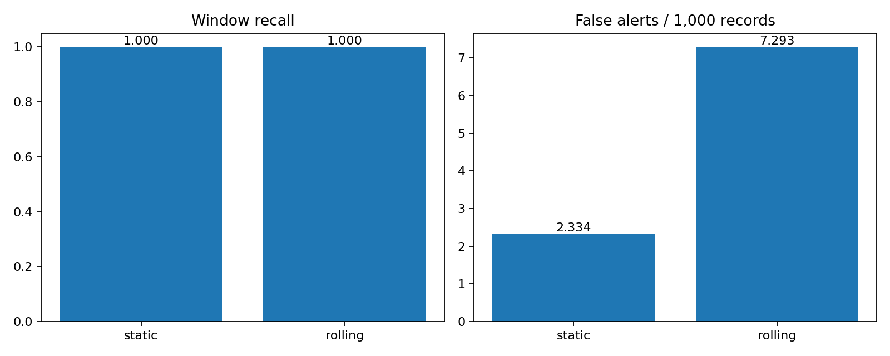

# Anomaly pipeline implementation validation

Validation date: 10 November 2026. These are implementation checks and a small initial quality experiment, not final course benchmark results.

## Implemented components

- Separate calibration, replay, offline reference, Spark streaming, comparison, observation and evaluation commands.
- Per-metric static baselines and rolling histories; score-before-update semantics and explicit flat-baseline behavior.
- Checkpointed Spark state, duplicate/stale input policy, bounded event-time buffering and finite-stream control events.
- A native committed Parquet sink with independently accessible static and rolling decisions in each record's JSON payload.
- Progress collection, state/throughput charts, a batch-completion latency proxy, and a polling observer for alert visibility.
- Window metrics and an adapter invoking the unmodified upstream NAB scorer.

The original ingestion source files, Airflow DAG, `pyproject.toml`, and `detection.py` were not modified for this enhancement. The README gained a link to the new runbook.

## Verification performed

Nine checks passed under Python 3.11.13, PySpark 3.5.1, Java 17, Pandas 2.2.3 and PyArrow 19.0.1:

1. Prior-value history and a jump from a constant baseline.
2. Rolling mean/standard deviation versus a sequential numerical reference through 2,000 updates and evictions.
3. State serialization/reconstruction across multiple batch boundaries.
4. Reordering across buffered batches and final drain.
5. Duplicate, late, invalid and unknown-metric rejection without baseline contamination.
6. Metric isolation and configuration-change rejection.
7. Distinct anomaly-window hits and false-alert counts.
8. Real Spark stop/restart, score parity, absence of duplicate committed event IDs, and correct progress-to-output latency matching.
9. Real Spark watermark/timeouts draining out-of-order events.

The restart test stops and recreates a query with the same checkpoint and additional input. It is not a process-kill or machine-failure test. Spark tests use a local streaming file source to exercise state and file commits without Kafka.

## Initial CloudWatch quality experiment

Configuration: 100 prior observations, 20 minimum observations, Z-score threshold 3, per-metric chronological 15% calibration prefix, absolute flat-baseline tolerance 0.01. The parameters were not optimized on these evaluation results. There is no cooldown.

Input: 12,096 original observations from three series. Calibration excluded 1,812 observations, leaving 10,284 evaluated observations. Spark and the offline reference agreed on all original event IDs, decisions, and numeric scores within the comparison tolerance. No original observation was missing or duplicated.

| Metric | Eligible windows | Static hits | Rolling hits | Static false alerts | Rolling false alerts |
| --- | ---: | ---: | ---: | ---: | ---: |
| `ec2_cpu_utilization_24ae8d.csv` | 2 | 2 | 2 | 11 | 12 |
| `ec2_cpu_utilization_c6585a.csv` | 0 | 0 | 0 | 12 | 21 |
| `ec2_network_in_257a54.csv` | 1 | 1 | 1 | 1 | 42 |
| Total | 3 | 3 | 3 | 24 | 75 |

Both methods achieved window recall 1.0 on this small selection. Static generated 2.334 false alerts per 1,000 evaluated observations; rolling generated 7.293. Recall is undefined for the series with no labeled windows. Hitting every window does not imply good overall detection quality: repeated false alerts can dominate the result.

Official upstream `nab.sweeper.Sweeper` was invoked using revision `ea702d75cc2258d9d7dd35ca8e5e2539d71f3140` and the standard cost profile. Normalization uses null and perfect baselines scored on the same three-series subset:

| Detector | Raw NAB score | Normalized subset score |
| --- | ---: | ---: |
| Static Z-score | 0.02554 | 50.426 |
| Rolling Z-score | -4.76316 | -29.386 |

The rolling result is below the null baseline under this profile. This is an observed limitation of the current defaults, not an implementation assertion that rolling must outperform static. The selected-series normalized score must not be compared directly with full-corpus leaderboard scores. Calibration suppression and the official scorer's capped probation period are recorded separately in the JSON report.

## Artifacts

- [Quality, status counts and progress metrics](cloudwatch_validation_metrics.json)
- [Official NAB scoring results and revision](cloudwatch_nab_scores.json)
- [Calibration parameters and source hashes](cloudwatch_calibration.json)
- [Spark/reference coverage and score comparison](cloudwatch_score_parity.json)
- [Commands for reproducing the experiment](../anomaly_pipeline_runbook.md)

## Remaining experiments and limits

Docker Desktop was manually paused during implementation. The daemon reported that state when inspected; Kafka replay, Kafka consumer lag, and Kafka-to-Spark end-to-end behavior could not be exercised. The Kafka source/producer path is implemented but is not yet verified against a running broker.

The saved progress metrics are from a finite file-source run in `local[2]` with four shuffle partitions. Their latency includes the time between writing replay input and starting Spark. It verifies metric matching, not live alert latency or sustainable throughput. No multi-host scale-out claim is supported by this run.

Before final presentation, complete the proposal's repeated input-rate/partition/resource experiments against a running broker, a process-kill recovery experiment, and quality evaluation across a broader declared subset with development/evaluation separation. A local batch-processing rate must not be reported as sustainable streaming capacity. Delayed-event integration was verified on a short synthetic series; NAB series with disjoint historical ranges must not share a buffered-mode global watermark.
